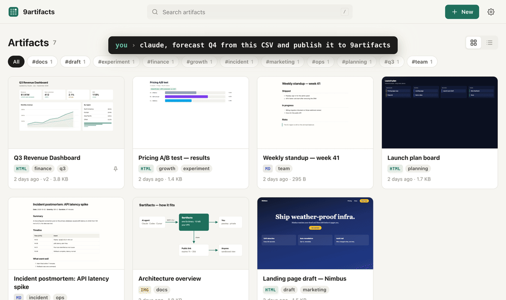
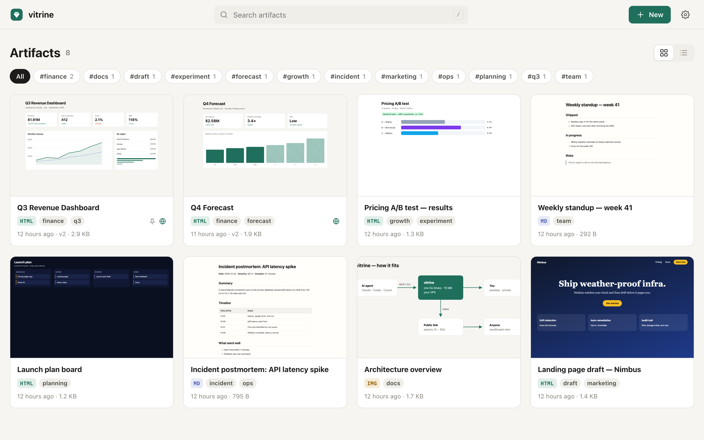
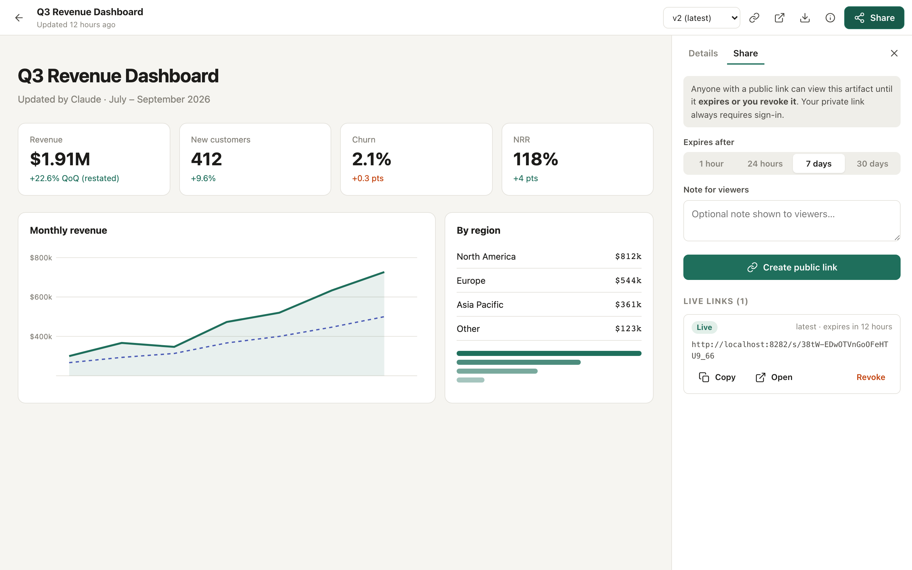
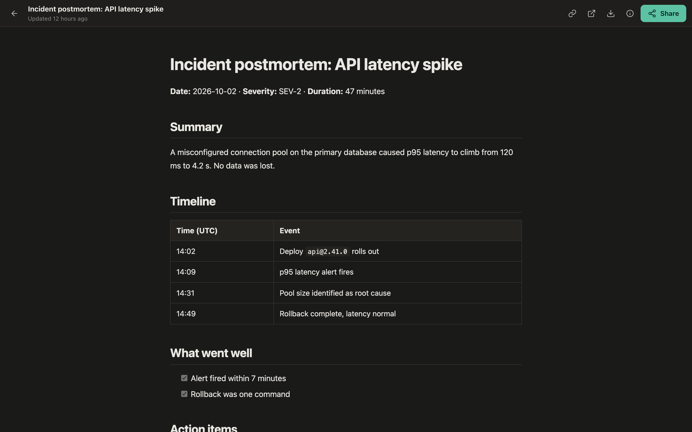
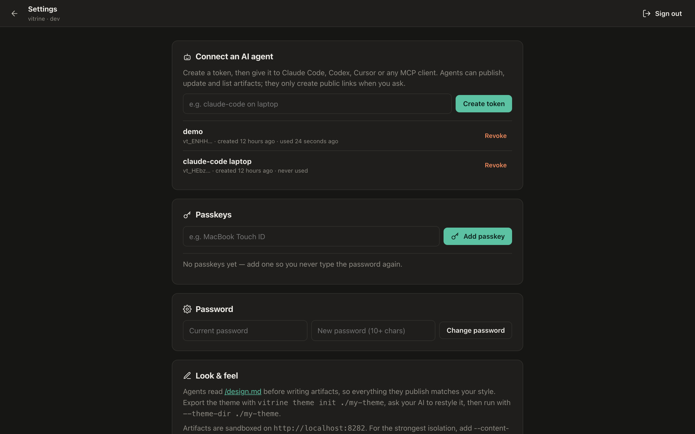
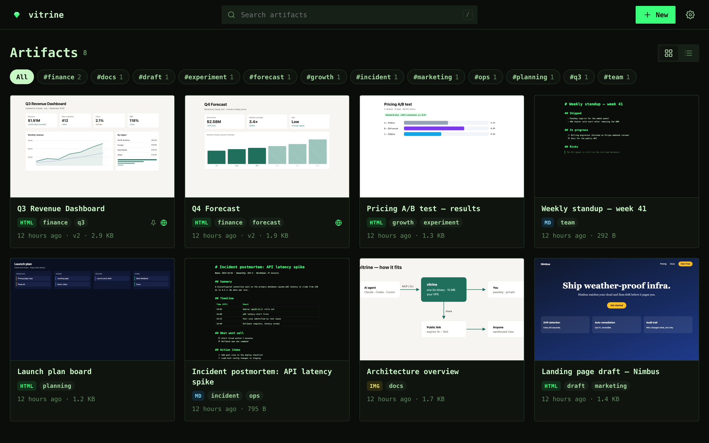
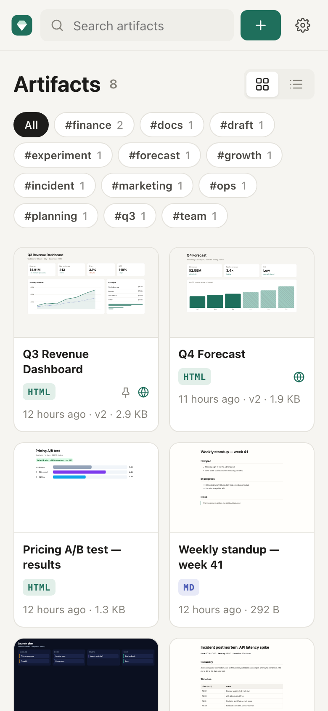
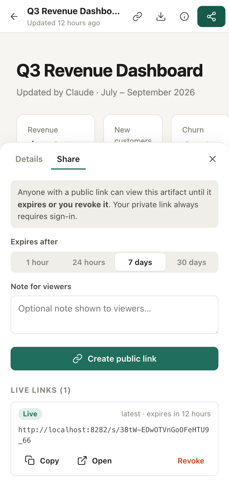

<div align="center">


# vitrine

**Claude-style artifacts on your own VPS.**
Your AI agents publish HTML, Markdown, diagrams and PDFs; you view them in a private, passkey-protected gallery and share expiring links when you want to.

One ~10 MB Go binary · ~10 MB RAM · no database · no Node · no Docker required

[](https://github.com/dinhkarate/vitrine/actions/workflows/ci.yml)
[](https://github.com/dinhkarate/vitrine/releases)
[](LICENSE)

English · [Tiếng Việt](README.vi.md)



</div>

## Why

Claude, ChatGPT, Codex and Cursor are great at producing **artifacts**: dashboards, reports,
diagrams, landing-page drafts. But they end up in a chat sidebar, a `/tmp` folder, or a public
link on someone else's servers.

If you already rent a VPS, Vitrine gives those artifacts a home you own:

- **Private by default.** Everything needs your passkey. Nothing is public until you create a
  link, and every public link **expires** (1 hour to 30 days) and can be revoked.
- **Made for agents.** A built-in **MCP server**, a CLI and an installable **agent skill** let
  Claude Code, Codex, Cursor or any MCP client publish and update artifacts. They get back a
  private URL to give you.
- **Feels like Claude's artifact viewer.** Full-bleed sandboxed viewer, version history, and
  **live reload**: when the agent publishes v2, your open tab updates by itself.
- **Your style, everywhere.** Agents read your `design.md` before writing, so everything they
  publish matches your look. The app UI is themeable too, and your AI can restyle it for you.
- **Tiny.** A single static binary with automatic HTTPS. It is happy on a 1 vCPU / 512 MB box,
  a Raspberry Pi, or a free-tier VM.

## Screenshots



| Viewer + expiring share links | Markdown, rendered |
|---|---|
|  |  |

| Connect an agent in one click | Themes: `terminal` and `paper` |
|---|---|
|  |  |

<p align="center"> </p>

## Quick start

### On a VPS (automatic HTTPS)

Point two DNS records at your server: one for the app, one for artifact content (see
[Security](#security) for why). Then run:

```bash
curl -fsSL https://raw.githubusercontent.com/dinhkarate/vitrine/main/install.sh \
  | sudo sh -s -- --domain art.example.com --content-domain art-content.example.com --email you@example.com
```

This installs the binary and a hardened systemd service. Vitrine fetches Let's Encrypt certificates
itself. Open the first-run link it prints, set a password, and add a passkey.

### Docker

```bash
docker run -d --name vitrine -p 8080:8080 -v vitrine:/data \
  -e VITRINE_URL=http://localhost:8080 ghcr.io/dinhkarate/vitrine
docker logs vitrine   # prints the first-run link
```

### From source

```bash
go install github.com/dinhkarate/vitrine/cmd/vitrine@latest
vitrine serve --url http://localhost:8080
```

Running behind nginx, Caddy or a Cloudflare Tunnel? See [docs/deploy.md](docs/deploy.md).
There is also a guide to hosting it on a **free** VM.

## Connect your AI agent

Create a token in **Settings → Connect an AI agent**. The page shows ready-to-paste commands,
or you can run `sudo vitrine token --data /var/lib/vitrine` on the server.

**Claude Code (MCP)**

```bash
claude mcp add --transport http vitrine https://art.example.com/mcp \
  --header "Authorization: Bearer vt_..."
```

Then just ask: *"Make a dashboard of this CSV and publish it to vitrine."*

**Any agent (skill + CLI)**

```bash
npx skills add dinhkarate/vitrine          # installs the vitrine skill for Claude Code, Codex, Cursor...
export VITRINE_URL=https://art.example.com VITRINE_TOKEN=vt_...
```

**CLI**

```bash
vitrine publish report.html --tags q3,finance        # → https://art.example.com/a/k3x...
vitrine publish ./site/                               # a folder: index.html + assets/
vitrine publish --update k3x... --keep report.html    # new version, same URL, live reload
vitrine share k3x... --ttl 7d                         # expiring public link
```

**curl**

```bash
curl -H "Authorization: Bearer $VITRINE_TOKEN" -F files=@report.html \
  https://art.example.com/api/artifacts
```

MCP tools: `get_design_guide`, `publish_artifact`, `list_artifacts`, `read_artifact`,
`share_artifact`, `revoke_share`, `delete_artifact`. The full REST API is in
[docs/api.md](docs/api.md).

## Make it yours

```bash
vitrine theme init ./my-theme            # theme.css, design.md, template.html, logo.svg, markdown.css
vitrine serve --theme-dir ./my-theme ...
```

- **`theme.css`** holds every colour, font and radius of the app as CSS variables, for both
  light and dark mode. Try asking your AI: *"Restyle my-theme/theme.css like Linear."*
- **`design.md` + `template.html`** form the house style for artifacts. Agents fetch them through
  MCP (`get_design_guide`) or `vitrine design` before writing, so a report made by Claude
  today and one made by Codex next month look like they belong together.
- Built-in themes: `default`, `terminal`, `paper` (`--theme terminal`).
- `vitrine theme init --full` also exports the app shell (HTML/JS/CSS) for deeper changes. Keep `nonce="{{.Nonce}}"` on the `<script>` tag in `index.html`, or the CSP will block the app.

## Security

Vitrine is meant for documents you would not paste into a public pastebin. The design:

| Concern | How Vitrine handles it |
|---|---|
| Malicious or buggy artifact JS | Every artifact response except PDFs carries `Content-Security-Policy: sandbox`, so it runs on an opaque origin with no cookies and no API access, even when opened in a new tab. Content types come from a fixed table, and unknown extensions download as `application/octet-stream`. With `--content-url`, artifacts also live on a **separate origin**, which is how Claude.ai isolates them. |
| Sub-resources in a sandbox | Short-lived HMAC **view tokens** are scoped to one artifact version, so sibling CSS and images load without exposing your session. |
| Login | **Passkeys** (WebAuthn, user verification required, signature-counter checks) or a PBKDF2 password. Lockout applies after 5 failures per address plus a global cap. Sessions use a `__Host-` cookie that is `HttpOnly`, `Secure` and `SameSite=Strict`, plus a CSRF header check. |
| Agent access | API tokens are stored only as SHA-256 hashes and can be revoked. Agents cannot mint tokens or change login settings. |
| Public links | Unguessable 144-bit tokens, **pinned to the version you shared**. Every link must expire, and revoked or expired links return `410 Gone`. |
| Logs | Share and view tokens are **redacted** from Vitrine's request log. |
| Files | Upload paths are validated and written through `os.Root`, so traversal is impossible. Responses are served with `nosniff`. |
| App UI | Nonce-based CSP (an uploaded `.js` can never run as app code), `X-Frame-Options: DENY`, and HSTS on HTTPS. |

Report vulnerabilities privately; see [SECURITY.md](SECURITY.md).

## How it compares

| | Vitrine | Claude.ai artifacts | Static hosting / S3 |
|---|---|---|---|
| Runs on your server | ✅ | ❌ | ✅ |
| Private by default | ✅ passkey | ❌ (publish = public) | ❌ |
| Expiring, revocable links | ✅ | ❌ | DIY |
| Any agent can publish (MCP / CLI / skill) | ✅ | Claude only | DIY |
| Versions + live reload | ✅ | ✅ | ❌ |
| Sandboxed, separate content origin | ✅ | ✅ | ❌ |
| Your design system applied by agents | ✅ `design.md` | ❌ | ❌ |
| Footprint | ~10 MB binary | — | — |

## FAQ

**Can I run it for free?** Yes. It fits easily in Oracle Cloud Always Free, a Google Cloud
`e2-micro` or a Raspberry Pi behind a free Cloudflare Tunnel. See [docs/deploy.md](docs/deploy.md#free-hosting).

**Multiple users?** Not yet. Vitrine is single-owner by design; share with others through expiring links.

**Where is my data?** Everything lives in one directory: a `vitrine.json` index plus your files under
`artifacts/<id>/v<n>/`. Back it up with `tar` or `restic`.

**Backups / migration?** Stop the service, copy the data directory, and start it on the new host.

## Roadmap

- [ ] Zip upload and folder upload from the browser
- [ ] Full-text search inside artifacts
- [ ] Optional client-side encryption for share links
- [ ] Per-artifact comments
- [ ] Read-only collaborators

## Contributing

Issues and PRs are welcome. Run `go test ./...` before sending a PR; see [CONTRIBUTING.md](CONTRIBUTING.md).
If Vitrine is useful to you, a ⭐ helps other self-hosters find it.

## License

[MIT](LICENSE)
