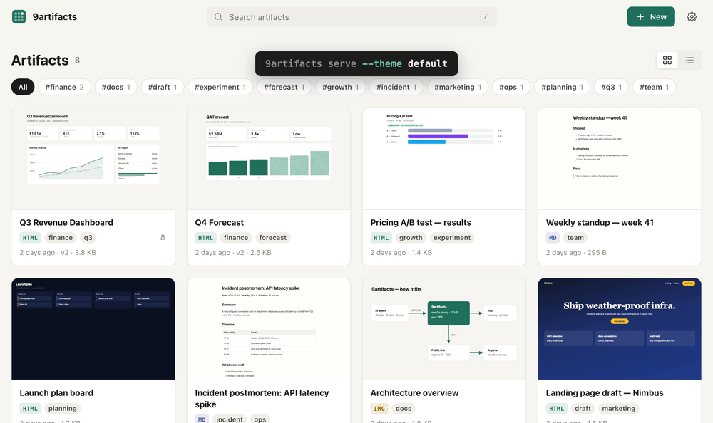

<div align="center">


# 9artifacts

**Artifact kiểu Claude, chạy trên VPS của bạn.**

**[Xem demo](https://demo.9artifacts.com)** · [Website](https://9artifacts.com) · [English](README.md) · Tiếng Việt

</div>

AI agent (Claude Code, Codex, Cursor…) tạo ra rất nhiều dashboard, báo cáo, sơ đồ. 9artifacts là nơi
lưu chúng **trên server của bạn**:

- **Riêng tư mặc định.** Đăng nhập bằng passkey. Link công khai **luôn có hạn** (1 giờ đến 30 ngày)
  và thu hồi được.
- **Cho agent dùng thẳng.** Có sẵn MCP server, CLI và skill (`npx skills add dinhkarate/9artifacts`).
  Agent publish xong trả về link riêng tư cho bạn.
- **Trải nghiệm giống Claude.** Viewer full màn hình chạy trong sandbox, có lịch sử phiên bản.
  Agent sửa xong thì tab đang mở **tự cập nhật**.
- **Phong cách của bạn.** Agent đọc `design.md` trước khi viết, nên artifact nào cũng theo đúng
  style của bạn. Sơ đồ dùng `diagram.css`, đường nối không đè lên hộp. Có sẵn 6 theme (`default`,
  `paper`, `terminal`, `cute`, `cyberpunk`, `edgy`), và có thể nhờ AI thiết kế lại theme. Theme đổi
  được mọi thứ: màu, font, card, nền, cả mascot.
- **Siêu nhẹ.** Một binary Go khoảng 10 MB, RAM khoảng 15 MB, tự lấy chứng chỉ HTTPS. Chạy tốt
  trên VPS 1 CPU / 512 MB hoặc VM miễn phí; có bản cho Linux, macOS, Windows, FreeBSD.



Thử đổi theme ngay trên [demo](https://demo.9artifacts.com) (ô chọn theme ở góc trên).

## Cài nhanh

Cách dễ nhất: dán câu này cho Claude Code, Codex hay Cursor (agent nào có shell cũng được):

> Install 9artifacts for me by following https://9artifacts.com/install.md. Put it on my server
> my-vps with the domains art.example.com and art-content.example.com, then connect yourself to it.

Hoặc tự cài:

```bash
curl -fsSL https://9artifacts.com/install.sh \
  | sudo sh -s -- --domain art.example.com --content-domain art-content.example.com --email ban@example.com
```

Mở link "first run" in ra trong log, đặt mật khẩu, thêm passkey, rồi vào **Settings → Connect an AI
agent** để lấy lệnh kết nối Claude Code:

```bash
claude mcp add --transport http 9artifacts https://art.example.com/mcp --header "Authorization: Bearer vt_..."
```

Muốn chạy **miễn phí**: máy của bạn + Tailscale (HTTPS `*.ts.net` free, không cần domain)
hoặc Cloudflare Tunnel, hay Oracle Cloud Always Free, Google Cloud `e2-micro`. Xem
[docs/deploy.md](docs/deploy.md#free-hosting).

Windows và macOS: tải bản build ở [Releases](https://github.com/dinhkarate/9artifacts/releases) rồi
làm theo [docs/deploy.md](docs/deploy.md#6-windows-and-macos). Không có server: dùng
[bản Cloudflare Workers](cloudflare/README.md) (gói free).

Tài liệu đầy đủ (bảo mật, API, theme) nằm trong [README tiếng Anh](README.md).
